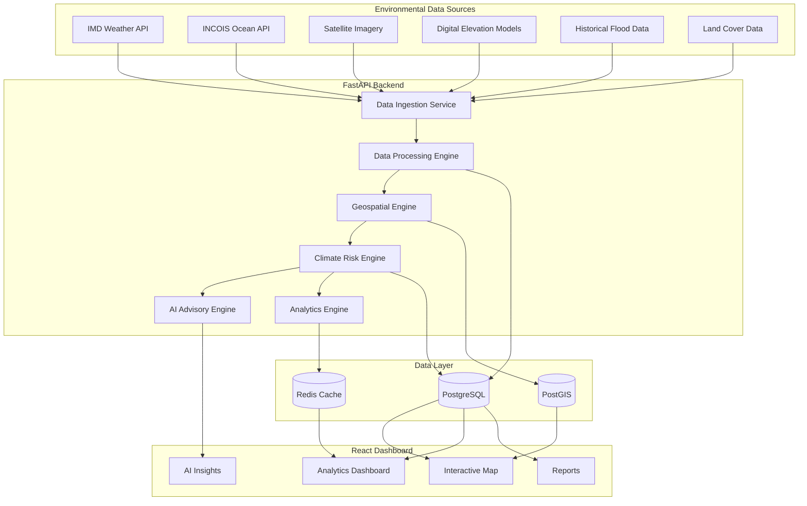
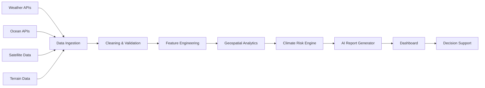
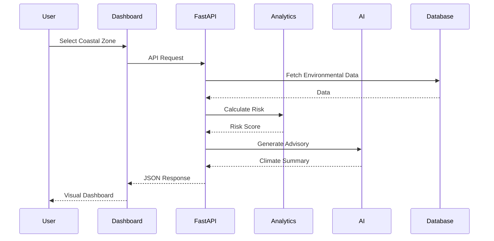
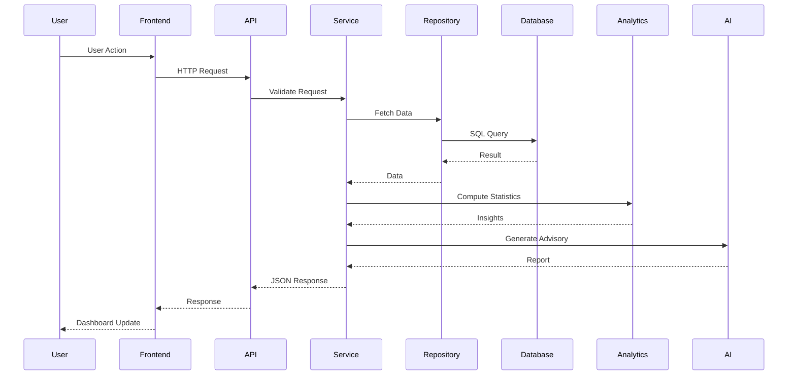
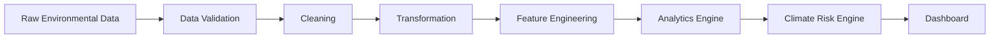

<div align="center">

# 🌊 Coastal Climate Risk Intelligence Platform

### AI-Powered Geospatial Decision Support System for Coastal Climate Risk Assessment

[]()
[]()
[]()
[]()
[]()

**Leveraging Artificial Intelligence, Geospatial Analytics, Remote Sensing, and Climate Data to Deliver Actionable Coastal Risk Intelligence**

---

*Building resilient coastal communities through data-driven decision making.*

</div>

---

# 📖 Table of Contents

- Overview
- Problem Statement
- Why This Project?
- Vision
- Objectives
- Key Features
- Product Highlights
- Technology Preview
- System Architecture
- Installation
- Documentation
- Roadmap
- Contributors

---

# 🌍 Overview

The **Coastal Climate Risk Intelligence Platform** is an AI-powered geospatial analytics platform designed to assess, visualize, and explain climate-related risks affecting coastal regions.

Unlike conventional weather dashboards, this platform combines **meteorological**, **oceanographic**, **geospatial**, and **historical climate datasets** into a unified intelligence system capable of generating **hyper-local climate risk assessments**.

The platform integrates multiple scientific datasets including:

- 🌧 Weather observations
- 🌊 Tide and ocean information
- 🛰 Satellite imagery
- 🗺 Digital Elevation Models
- 🌱 Land cover information
- 📈 Historical climate records

These datasets are processed through an analytics pipeline to compute a **Composite Climate Risk Index**, which is then presented through interactive dashboards, statistical visualizations, and AI-generated advisory reports.

The goal is not only to visualize environmental risks but also to assist policymakers, disaster management authorities, insurance agencies, researchers, and citizens in making informed decisions.

---

# ❗ Problem Statement

Coastal regions worldwide are experiencing increasingly severe impacts from climate change, including:

- Rising sea levels
- Coastal erosion
- Flash floods
- Heavy monsoon rainfall
- Storm surges
- Infrastructure damage
- Population displacement

Although large volumes of environmental data are publicly available, these datasets remain fragmented across different organizations and formats.

As a result, stakeholders face several challenges:

- Lack of integrated climate intelligence
- Limited neighborhood-level risk assessment
- Difficulty interpreting raw environmental data
- Delayed disaster preparedness
- Absence of AI-assisted decision support

Current solutions often focus on displaying weather conditions rather than providing meaningful, actionable insights.

Our platform addresses this gap by transforming heterogeneous environmental datasets into an explainable and interactive climate intelligence system.

---

# 💡 Why This Project?

Most existing solutions answer questions such as:

> "What is today's weather?"

This project answers far more important questions:

- Which coastal areas are most vulnerable today?
- Why is a particular location classified as high risk?
- Which environmental factors contribute most to the risk?
- How has the risk evolved over time?
- Which communities require immediate attention?
- What preventive actions should authorities consider?

Rather than functioning as a traditional weather application, this platform serves as an **AI-assisted Decision Support System (DSS)**.

---

# 🎯 Vision

To build an intelligent, scalable, and explainable climate intelligence platform that empowers governments, researchers, disaster management agencies, insurance providers, and citizens with real-time, data-driven insights for proactive coastal risk management.

---

# 🚀 Objectives

The primary objectives of this project are:

- Aggregate environmental datasets from multiple trusted sources.
- Perform geospatial analytics on coastal regions.
- Compute a Composite Climate Risk Index.
- Generate AI-powered climate advisories.
- Visualize risks using interactive maps and statistical dashboards.
- Support evidence-based policy and disaster response planning.
- Deliver explainable AI insights rather than black-box predictions.

---

# ⭐ Key Features

## 🌍 Geospatial Intelligence

- Interactive GIS Dashboard
- Heatmaps
- Risk Layer Visualization
- Satellite View
- Terrain View
- Coastal Zone Mapping
- Ward-Level Risk Analysis

---

## 📊 Climate Analytics

- Rainfall Analysis
- Tide Trend Analysis
- Historical Climate Trends
- Flood Pattern Analysis
- Elevation Analysis
- Population Exposure Analysis
- Time-Series Analytics

---

## 🤖 Artificial Intelligence

- AI-generated Risk Reports
- Natural Language Climate Summaries
- Explainable Risk Analysis
- Automated Advisory Generation
- Intelligent Insight Extraction
- Recommendation Engine

---

## 📈 Statistical Dashboard

- Interactive Charts
- Trend Analysis
- Correlation Analysis
- Risk Distribution
- Top High-Risk Regions
- Historical Comparison
- Forecast Visualization

---

## 🛰 Environmental Data Integration

- Weather APIs
- Ocean Data
- Satellite Data
- Elevation Models
- Historical Climate Records
- Land Cover Data

---

## 📄 Reporting

- Downloadable Reports
- AI Executive Summary
- CSV Export
- PDF Export
- Climate Intelligence Snapshot

---

# 🌟 Product Highlights

✅ AI-Powered Climate Intelligence

✅ Explainable Risk Assessment

✅ Interactive GIS Dashboard

✅ Statistical Analytics Dashboard

✅ Hyper-Local Risk Mapping

✅ Real-Time Environmental Monitoring

✅ Historical Trend Analysis

✅ Climate Risk Forecasting

✅ Decision Support System

✅ Modular & Scalable Architecture

---

# 🏗 Project Philosophy

This project is designed around four engineering principles:

### 1. Explainability

Every risk score generated by the platform should be explainable through contributing environmental factors.

---

### 2. Scientific Accuracy

Risk assessments are derived from validated environmental datasets rather than arbitrary estimations.

---

### 3. Scalability

The architecture is modular, allowing additional cities, datasets, AI models, and analytical modules to be integrated with minimal changes.

---

### 4. User-Centric Decision Support

The platform focuses on transforming raw environmental data into actionable intelligence that supports better decision-making.

---

# 👥 Target Users

This platform is intended for:

🏛 Government Agencies

🌊 Coastal Management Authorities

🚨 Disaster Management Teams

🏢 Insurance Companies

🏗 Urban Planners

🔬 Climate Researchers

🎓 Academic Institutions

👨‍💻 Environmental Analysts

🌍 Citizens

---

# 📚 Documentation

Comprehensive project documentation is available inside the `/docs` directory.

```
docs/

├── 01-PRD.md
├── 02-TRD.md
├── 03-APP_FLOW.md
├── 04-UI_UX_BRIEF.md
├── 05-BACKEND_SCHEMA.md
├── 06-IMPLEMENTATION_PLAN.md
├── 07-AI_ARCHITECTURE.md
├── 08-DEPLOYMENT.md
└── 09-CONTRIBUTING.md
```

Each document acts as the source of truth for a specific aspect of the system, ensuring a structured and maintainable development process.

---

> **Note:** This project is currently under active development. Features and architecture may evolve as implementation progresses.
---

# 🏛 System Architecture

The Coastal Climate Risk Intelligence Platform follows a modular, service-oriented architecture designed for scalability, maintainability, and future extensibility.

Rather than coupling data ingestion, analytics, AI, and visualization into a monolithic application, the platform separates each responsibility into independent modules.

This architecture enables:

- Independent module development
- Easier testing and debugging
- Future AI model replacement
- Support for multiple coastal cities
- Horizontal scalability
- Clean separation of concerns

---

## 🏗 High-Level Architecture



---

# 🔄 End-to-End Data Pipeline

The platform processes environmental information through a multi-stage analytics pipeline before presenting actionable insights to end users.



---

# 🌍 Geospatial Processing Pipeline

Geospatial analysis is the foundation of the platform.

Spatial datasets are transformed into structured intelligence using GIS techniques before being used for risk computation.

```mermaid
flowchart LR

Satellite Images

-->

Raster Processing

-->

Elevation Analysis

-->

Terrain Mapping

-->

Spatial Overlay

-->

Risk Zones

-->

Interactive GIS Dashboard
```

---

# 🤖 AI Processing Pipeline

Artificial Intelligence is responsible for translating analytical outputs into understandable recommendations.

The AI **does not calculate risk**.

Instead, it explains the outputs generated by the Climate Risk Engine.

```mermaid
flowchart LR

Climate Risk Score

-->

Context Builder

-->

Prompt Generator

-->

LLM

-->

Climate Advisory

-->

Dashboard
```

---

# 📊 Climate Risk Computation Pipeline

The Climate Risk Engine combines multiple environmental indicators into a Composite Climate Risk Index.

```mermaid
flowchart LR

Rainfall

-->

Feature Normalization

Tide Height

-->

Feature Normalization

Elevation

-->

Feature Normalization

Historical Floods

-->

Feature Normalization

Population Density

-->

Feature Normalization

Feature Normalization

-->

Weighted Risk Model

-->

Composite Risk Score

-->

Risk Classification
```

---

# 🧠 Core System Components

The platform consists of six independent modules.

---

## 1️⃣ Data Ingestion Service

Responsible for:

- Collecting weather observations
- Fetching tide information
- Importing satellite imagery
- Importing terrain datasets
- Synchronizing historical records

Output:

Validated environmental datasets.

---

## 2️⃣ Geospatial Analytics Engine

Responsible for:

- Coordinate transformation
- Spatial joins
- Elevation analysis
- Coastal boundary extraction
- Heatmap generation
- Zone segmentation

Output:

Spatial intelligence.

---

## 3️⃣ Climate Risk Engine

The analytical heart of the platform.

Responsibilities:

- Feature engineering
- Risk normalization
- Weighted scoring
- Zone classification
- Confidence estimation

Output:

Composite Climate Risk Index.

---

## 4️⃣ AI Advisory Engine

Responsible for:

- Climate summaries
- Executive reports
- Explainable AI
- Risk explanation
- Government recommendations
- Citizen advisories

Output:

Natural-language insights.

---

## 5️⃣ Analytics Engine

Responsible for:

- Statistical analysis
- Time-series analysis
- Trend detection
- Correlation analysis
- Historical comparisons

Output:

Interactive dashboards.

---

## 6️⃣ Visualization Layer

Responsible for presenting insights through:

- Interactive GIS maps
- Charts
- Tables
- Filters
- Reports
- Export tools

---

# ⚙ Request Lifecycle

Every user request follows the same processing lifecycle.



---

# 🔐 Architecture Principles

The architecture follows several software engineering principles:

### Separation of Concerns

Every module has a single responsibility.

---

### Scalability

Additional coastal cities can be integrated without architectural changes.

---

### Explainability

Every climate risk score is traceable back to contributing environmental variables.

---

### Maintainability

Independent services reduce coupling and simplify future enhancements.

---

### Extensibility

New AI models, weather APIs, and analytical modules can be added with minimal modifications.

---
                React Dashboard
                      │
──────────────────── API Gateway ────────────────────
                      │
 ┌──────────┬──────────┬──────────┬──────────┐
 │          │          │          │          │
 │Data      │GIS       │Analytics │AI        │Risk
 │Service   │Service   │Service   │Service   │Engine
 └──────────┴──────────┴──────────┴──────────┘
                      │
             PostgreSQL + PostGIS
---

# 🛠 Technology Stack

The Coastal Climate Risk Intelligence Platform is built using a modern, production-ready, open-source technology stack designed for scalability, performance, maintainability, and cost efficiency.

Every technology has been selected after evaluating multiple alternatives based on the following criteria:

- Performance
- Community Support
- Scalability
- Production Readiness
- Learning Curve
- Cost
- Long-Term Maintainability

---

# 🏗 Complete Technology Stack

| Layer | Technology | Purpose |
|---------|------------|---------|
| Frontend | React + Vite | Interactive Dashboard |
| UI | Tailwind CSS + shadcn/ui | Modern User Interface |
| Backend | FastAPI | REST API Server |
| Database | PostgreSQL | Relational Data Storage |
| GIS Database | PostGIS | Spatial Database |
| Cache | Redis | API & Analytics Cache |
| Geospatial | GeoPandas | GIS Analytics |
| Raster Processing | Rasterio | Satellite Data Processing |
| Geometry Engine | Shapely | Spatial Operations |
| Data Processing | Pandas | Data Cleaning |
| Numerical Computing | NumPy | Scientific Computation |
| Machine Learning | Scikit-Learn | Statistical Models |
| AI Model | Qwen 3 Instruct | Advisory Generation |
| Embeddings | BAAI BGE-M3 | Semantic Retrieval |
| OCR | PaddleOCR | Document Extraction |
| Charts | Plotly + Recharts | Interactive Analytics |
| Maps | MapLibre GL + Leaflet | GIS Visualization |
| Deployment | Docker | Containerization |
| Reverse Proxy | Nginx | Production Web Server |

---

# 💻 Frontend Technology

## React + Vite

### Why React?

React remains the most widely adopted frontend framework in enterprise software development.

Advantages

- Component-based architecture
- Large ecosystem
- Easy state management
- Excellent GIS integration
- Massive community

---

### Why Vite instead of Create React App?

| Vite | CRA |
|-------|-----|
| Lightning-fast startup | Slow startup |
| Instant HMR | Slower reload |
| Smaller bundles | Larger bundles |
| Modern tooling | Legacy tooling |

**Decision**

✅ React + Vite

---

# 🎨 UI Framework

## Tailwind CSS

Why?

- Utility-first
- Responsive by default
- Smaller CSS bundle
- Easy customization

---

## Why shadcn/ui?

Instead of traditional UI libraries like Material UI,

we chose

shadcn/ui

because

- Fully customizable
- No vendor lock-in
- Modern design
- Better accessibility
- Lightweight

---

# ⚡ Backend

## FastAPI

FastAPI was selected after evaluating Flask and Django.

| Feature | FastAPI | Flask | Django |
|-----------|----------|--------|---------|
| Async | ✅ | ❌ | Partial |
| Performance | ⭐⭐⭐⭐⭐ | ⭐⭐⭐ | ⭐⭐⭐ |
| Auto API Docs | ✅ | ❌ | ❌ |
| Type Validation | ✅ | ❌ | Partial |
| Learning Curve | Easy | Easy | Moderate |

### Decision

FastAPI provides significantly better performance for data-intensive analytical applications while reducing boilerplate through automatic validation and API documentation.

---

# 🗄 Database

## PostgreSQL + PostGIS

Why not MongoDB?

This application stores highly relational and geospatial data.

Examples:

- Ward boundaries
- Elevation polygons
- Flood zones
- Spatial intersections
- Distance calculations

MongoDB lacks native GIS capabilities comparable to PostGIS.

---

### PostgreSQL Advantages

- ACID compliant
- Spatial indexing
- Mature ecosystem
- SQL support
- Excellent analytical performance

---

### Why PostGIS?

PostGIS extends PostgreSQL with spatial capabilities.

Supports:

- Polygon Analysis
- Spatial Join
- Buffer Analysis
- Distance Queries
- Coordinate Transformation
- Heatmaps

Without PostGIS, implementing GIS features would be significantly more complex.

---

# 🌍 Geospatial Stack

## GeoPandas

Responsible for

- Spatial joins
- GIS overlays
- Vector analysis

---

## Rasterio

Responsible for

- DEM processing
- Satellite imagery
- Raster manipulation

---

## Shapely

Responsible for

- Polygon operations
- Geometry calculations
- Spatial relationships

---

# 📊 Data Analytics

## Pandas

Responsible for

- Data Cleaning
- Data Transformation
- Missing Value Handling
- Aggregation

---

## NumPy

Responsible for

- Matrix Operations
- Numerical Computation
- Scientific Processing

---

## Scikit-Learn

Used for

- Statistical Modeling
- Feature Engineering
- Correlation Analysis
- Clustering
- Prediction Models

---

# 🤖 Artificial Intelligence

The platform uses Large Language Models only for reasoning and explanation.

The AI **does not** calculate climate risk.

Risk computation remains deterministic and scientifically explainable.

---

## Selected Model

### Qwen 3 Instruct

Primary responsibilities

- Climate advisory generation
- Executive summaries
- Explainability
- Recommendation generation

---

## Why Qwen?

| Feature | Qwen 3 | Gemma 3 | Llama 3.1 | Mistral Small |
|-----------|----------|-----------|-------------|----------------|
| Reasoning | ⭐⭐⭐⭐⭐ | ⭐⭐⭐⭐ | ⭐⭐⭐⭐⭐ | ⭐⭐⭐⭐ |
| Speed | ⭐⭐⭐⭐ | ⭐⭐⭐⭐⭐ | ⭐⭐⭐ | ⭐⭐⭐⭐⭐ |
| Context Window | ⭐⭐⭐⭐⭐ | ⭐⭐⭐⭐ | ⭐⭐⭐⭐ | ⭐⭐⭐ |
| Instruction Following | ⭐⭐⭐⭐⭐ | ⭐⭐⭐⭐ | ⭐⭐⭐⭐ | ⭐⭐⭐⭐ |
| Apache License | ✅ | ❌ | ❌ | ✅ |
| Local Deployment | Excellent | Excellent | Heavy | Excellent |

### Decision

**Qwen 3 Instruct** offers the best balance of reasoning quality, context length, deployment flexibility, and open licensing for this project's AI advisory tasks.

---

# 🔍 Embedding Model

## Selected

BAAI BGE-M3

Purpose

Semantic search and retrieval.

---

### Comparison

| Model | Accuracy | Speed | Multilingual | Overall |
|----------|------------|----------|----------------|------------|
| BGE-M3 | ⭐⭐⭐⭐⭐ | ⭐⭐⭐⭐ | ⭐⭐⭐⭐⭐ | 🥇 |
| E5-Large-v2 | ⭐⭐⭐⭐ | ⭐⭐⭐⭐ | ⭐⭐⭐⭐ | 🥈 |
| Nomic Embed | ⭐⭐⭐ | ⭐⭐⭐⭐⭐ | ⭐⭐⭐ | 🥉 |

---

# 📄 OCR Engine

Selected

PaddleOCR

---

Why PaddleOCR?

Compared to Tesseract

- Better accuracy
- Better table extraction
- Faster inference
- Active development
- Better multilingual support

---

# 📈 Visualization

## Plotly

Used for

- Time Series
- Correlation Analysis
- Interactive Charts

---

## Recharts

Used for

- Dashboard Cards
- KPI Charts
- Statistical Widgets

---

## MapLibre GL

Responsible for

- Interactive Maps
- GIS Layers
- Heatmaps

---

# 🐳 Deployment Stack

| Component | Technology |
|------------|------------|
| Containerization | Docker |
| Reverse Proxy | Nginx |
| API Server | Uvicorn |
| Cache | Redis |
| Monitoring | Prometheus |
| Visualization | Grafana |

---

# 🏛 Engineering Philosophy

Every technology selected for this project satisfies four requirements:

- Open Source
- Production Ready
- Scalable
- Community Supported

The platform intentionally avoids proprietary dependencies wherever practical, ensuring long-term maintainability and reducing deployment costs.

---
---

# 📂 Project Structure

The project follows a modular, feature-oriented architecture inspired by Clean Architecture and Domain-Driven Design (DDD).

Each module has a single responsibility, making the system easier to maintain, test, and extend.

```
coastal-climate-risk-intelligence/
│
├── 📂 frontend/                     # React + Vite Application
│   ├── public/
│   ├── src/
│   │   ├── assets/
│   │   ├── components/
│   │   ├── layouts/
│   │   ├── pages/
│   │   ├── services/
│   │   ├── hooks/
│   │   ├── contexts/
│   │   ├── utils/
│   │   ├── styles/
│   │   ├── routes/
│   │   ├── types/
│   │   └── App.tsx
│   │
│   └── package.json
│
├── 📂 backend/
│   ├── app/
│   │   ├── api/
│   │   ├── core/
│   │   ├── config/
│   │   ├── services/
│   │   ├── analytics/
│   │   ├── geospatial/
│   │   ├── ai/
│   │   ├── models/
│   │   ├── schemas/
│   │   ├── repositories/
│   │   ├── database/
│   │   ├── middleware/
│   │   ├── utils/
│   │   └── main.py
│   │
│   ├── tests/
│   └── requirements.txt
│
├── 📂 data/
│   ├── raw/
│   ├── processed/
│   ├── gis/
│   └── historical/
│
├── 📂 models/
│   ├── llm/
│   ├── embeddings/
│   └── checkpoints/
│
├── 📂 docker/
│
├── 📂 scripts/
│
├── 📂 docs/
│
├── docker-compose.yml
├── README.md
└── LICENSE
```

---

# 🏛 Backend Architecture

The backend is organized into independent business domains rather than technical layers.

This keeps the codebase modular and allows each component to evolve independently.

```
FastAPI

│

├── API Layer

├── Business Services

├── Analytics Engine

├── Geospatial Engine

├── AI Engine

├── Repository Layer

└── Database
```

---

# 📦 Backend Module Responsibilities

## API Layer

Responsible for

- REST Endpoints
- Request Validation
- Response Formatting
- Authentication (Future)
- API Documentation

---

## Service Layer

Contains all business logic.

Examples

- Risk computation
- Report generation
- Data aggregation
- Forecast generation

No database logic should exist here.

---

## Repository Layer

Responsible only for database interaction.

Responsibilities

- CRUD Operations
- Spatial Queries
- Filtering
- Pagination

Business logic should never exist inside repositories.

---

## Analytics Engine

Responsible for

- Time-series analytics
- Statistical summaries
- Trend analysis
- Correlation computation
- Aggregation

---

## Geospatial Engine

Responsible for

- Spatial joins
- Polygon operations
- Buffer generation
- Distance computation
- Heatmap generation
- Coordinate transformations

---

## AI Engine

Responsible for

- Prompt construction
- AI report generation
- Explainability
- Recommendation generation
- Climate summaries

The AI Engine **never** computes climate risk directly.

---

# 🎨 Frontend Architecture

The frontend follows a feature-based organization.

```
Pages

↓

Layouts

↓

Reusable Components

↓

Hooks

↓

API Services

↓

Backend
```

---

## Pages

Examples

- Dashboard
- Analytics
- Reports
- Settings
- About

Pages contain layout composition only.

Business logic remains inside hooks and services.

---

## Components

Reusable UI elements

Examples

- Charts
- Cards
- KPIs
- Sidebar
- Navbar
- Map Widgets
- Tables

---

## Services

Responsible for

- API Requests
- Data Fetching
- Caching
- Error Handling

---

## Hooks

Reusable application logic

Examples

- useWeather()
- useRiskAnalysis()
- useAnalytics()
- useMaps()

---

# 🗄 Database Architecture

The application uses PostgreSQL with PostGIS.

```
Frontend

↓

FastAPI

↓

Repository Layer

↓

PostgreSQL

↓

PostGIS
```

---

## Why Repository Pattern?

Instead of allowing every service to directly access the database,

all database interactions pass through repositories.

Benefits

- Easier testing
- Cleaner architecture
- Better maintainability
- Easy migration
- Reduced coupling

---

# 🔄 Request Lifecycle

Every API request follows the same flow.



---

# 🧪 Testing Strategy

The platform follows a layered testing approach.

```
Unit Tests

↓

Integration Tests

↓

API Tests

↓

Frontend Tests

↓

End-to-End Tests
```

---

## Unit Testing

Covers

- Utility functions
- Risk calculations
- Data processing
- AI prompt generation

---

## Integration Testing

Validates

- Database communication
- GIS processing
- API integration
- Analytics pipeline

---

## API Testing

Ensures

- Correct responses
- Validation
- Status codes
- Error handling

---

## End-to-End Testing

Simulates complete user workflows

Examples

- View risk dashboard
- Generate AI report
- Filter high-risk zones
- Export reports

---

# 🔒 Security Considerations

Although this project is an MVP, the architecture has been designed with production security in mind.

Planned security measures include

- HTTPS
- Secure API Keys
- Environment Variables
- SQL Injection Prevention
- Input Validation
- Rate Limiting
- Role-Based Access Control
- Audit Logging

---

# ⚡ Performance Optimizations

To ensure scalability and responsiveness, the platform incorporates:

- Redis caching for frequently accessed data
- Spatial indexing using PostGIS
- Lazy loading for large map layers
- API pagination
- Background task processing
- Asynchronous FastAPI endpoints
- Optimized geospatial queries

---

# 🏗 Design Principles

The architecture is guided by the following software engineering principles.

### Single Responsibility Principle

Every module has one clearly defined responsibility.

---

### Dependency Inversion

Business logic depends on abstractions rather than implementation details.

---

### Separation of Concerns

Analytics, AI, GIS, API, and persistence remain independent.

---

### Open-Closed Principle

New data sources, AI models, and analytical modules can be added without modifying existing components.

---

### Scalability First

The architecture supports future expansion to additional coastal cities, new environmental datasets, and more advanced predictive models without major restructuring.

---
---

# 🚀 Getting Started

Follow the steps below to set up the Coastal Climate Risk Intelligence Dashboard on your local machine.

---

# 📋 Prerequisites

Before installing the project, ensure the following software is installed.

| Software | Version |
|-----------|---------|
| Python | 3.11+ |
| Node.js | 20+ |
| PostgreSQL | 16+ |
| PostGIS | Latest |
| Redis | Latest |
| Docker | Latest |
| Git | Latest |

---

# ⚙️ Local Installation

## 1. Clone the Repository

```bash
git clone https://github.com/your-username/coastal-climate-risk-intelligence-dashboard.git

cd coastal-climate-risk-intelligence-dashboard
```

---

## 2. Frontend Setup

```bash
cd frontend

npm install

npm run dev
```

Frontend will start at

```
http://localhost:5173
```

---

## 3. Backend Setup

```bash
cd backend

python -m venv .venv
```

Activate environment

Windows

```bash
.venv\Scripts\activate
```

Linux / Mac

```bash
source .venv/bin/activate
```

Install dependencies

```bash
pip install -r requirements.txt
```

Run FastAPI

```bash
uvicorn app.main:app --reload
```

Backend

```
http://localhost:8000
```

Swagger Documentation

```
http://localhost:8000/docs
```

---

# 🐳 Running with Docker

The project includes Docker support for a consistent development environment.

Start all services

```bash
docker compose up --build
```

Services started

- Frontend
- Backend
- PostgreSQL
- PostGIS
- Redis

Stop services

```bash
docker compose down
```

---

# 🔑 Environment Variables

Create a `.env` file inside the backend directory.

```env
# Database

POSTGRES_USER=postgres
POSTGRES_PASSWORD=password
POSTGRES_DB=climate_db

# Redis

REDIS_HOST=redis
REDIS_PORT=6379

# AI

LLM_PROVIDER=local
LLM_MODEL=qwen3

# APIs

IMD_API_KEY=
INCOIS_API_KEY=

# Application

APP_ENV=development
```

> **Note:** API keys are intentionally omitted from the repository. Use your own credentials where required.

---

# 📡 External Data Sources

The platform aggregates trusted environmental datasets from multiple providers.

| Source | Purpose |
|---------|---------|
| IMD | Weather observations |
| INCOIS | Tide & Ocean Data |
| Sentinel | Satellite Imagery |
| Landsat | Remote Sensing |
| Digital Elevation Models | Terrain Analysis |
| Historical Flood Records | Risk Modelling |

---

# 🌍 Data Processing Workflow



---

# 📊 Composite Climate Risk Index

The platform computes a **Composite Climate Risk Index (CCRI)** by combining multiple environmental indicators.

Primary contributing factors include:

- Rainfall Intensity
- Tide Height
- Elevation
- Distance from Coast
- Historical Flood Frequency
- Land Cover Characteristics
- Population Exposure

Each factor is normalized and contributes to the final score through a weighted analytical model.

Risk Categories

| Score | Risk Level |
|--------|------------|
| 0 – 20 | Low |
| 21 – 40 | Moderate |
| 41 – 60 | High |
| 61 – 80 | Very High |
| 81 – 100 | Critical |

---

# 🤖 AI Advisory Workflow

The AI module transforms analytical outputs into natural-language insights.

It is responsible for:

- Executive Summaries
- Climate Advisories
- Zone Explanations
- Action Recommendations
- Explainable Insights

The AI **does not** calculate environmental risk.

It only interprets outputs generated by the Climate Risk Engine.

---

# 📈 Dashboard Modules

The dashboard is divided into several analytical sections.

### 🌍 Geospatial Dashboard

- Interactive Map
- Heatmaps
- Risk Layers
- Satellite View
- Terrain View

---

### 📊 Analytics Dashboard

- Rainfall Trends
- Tide Analysis
- Historical Trends
- Correlation Analysis
- High-Risk Zones

---

### 🤖 AI Insights

- Climate Summary
- Risk Explanation
- Recommendations
- Executive Reports

---

### 📄 Reports

- PDF Export
- CSV Export
- Executive Summary
- Historical Reports

---

# 📌 API Overview

| Method | Endpoint | Description |
|----------|----------|-------------|
| GET | /api/weather | Weather data |
| GET | /api/tides | Tide information |
| GET | /api/risk | Climate Risk Score |
| GET | /api/analytics | Statistical Insights |
| GET | /api/report | AI Generated Report |

> Complete API documentation is available via FastAPI Swagger UI.

---

# 📚 Documentation

The repository follows a documentation-first development workflow.

| Document | Description |
|-----------|-------------|
| README.md | Project Overview |
| PRD | Product Requirements |
| TRD | Technical Requirements |
| APP_FLOW | User Journey |
| UI_UX_BRIEF | Design Guidelines |
| BACKEND_SCHEMA | Database Design |
| IMPLEMENTATION_PLAN | Development Roadmap |

---
---

# 🛣 Development Roadmap

The project will be developed in multiple phases to ensure a stable, scalable, and maintainable implementation.

## Phase 1 — Project Foundation

- Repository setup
- Development environment configuration
- Docker configuration
- PostgreSQL + PostGIS setup
- FastAPI backend initialization
- React frontend initialization
- Documentation completion

---

## Phase 2 — Data Ingestion

- Weather API integration
- Ocean data integration
- Satellite imagery ingestion
- Digital Elevation Model integration
- Historical climate dataset integration
- Data validation and preprocessing

---

## Phase 3 — Geospatial Analytics

- Spatial data processing
- Coordinate transformation
- GIS layer generation
- Heatmap creation
- Risk zone segmentation
- Elevation analysis

---

## Phase 4 — Climate Risk Engine

- Feature engineering
- Composite Climate Risk Index calculation
- Risk classification
- Trend analysis
- Statistical analysis
- Risk confidence estimation

---

## Phase 5 — AI Intelligence

- Local LLM integration
- AI advisory generation
- Executive summaries
- Explainable AI reports
- Recommendation engine

---

## Phase 6 — Dashboard

- Interactive maps
- Statistical charts
- AI insights panel
- Reports
- Filters
- Search functionality

---

## Phase 7 — Testing & Deployment

- Unit testing
- API testing
- Integration testing
- Performance optimization
- Docker deployment
- Production release

---

# 🔒 Security & Privacy

Security has been considered throughout the system architecture.

## Security Measures

- Secure environment variables
- API input validation
- SQL injection prevention
- HTTPS-ready deployment
- Secure database access
- Role-Based Access Control (Future)
- API rate limiting (Future)

---

## Data Privacy

The platform processes publicly available environmental datasets.

No personally identifiable information (PII) is collected or stored.

Future enterprise deployments can integrate secure authentication and encrypted storage if required.

---

# 📈 Scalability

The architecture has been designed for future expansion.

Future improvements include:

- Multi-city support
- National coastal monitoring
- Real-time streaming data
- Distributed processing
- Machine learning forecasting
- Multi-language support
- Mobile application
- Public REST API

---

# 🧪 Testing Strategy

To ensure reliability, the project follows a layered testing approach.

## Backend Testing

- Unit Tests
- Integration Tests
- API Tests
- Database Tests

---

## Frontend Testing

- Component Testing
- UI Testing
- Responsive Testing
- Accessibility Testing

---

## End-to-End Testing

Complete workflow validation including:

- Data ingestion
- Risk computation
- Dashboard rendering
- AI report generation
- Report export

---

# ⚡ Performance Goals

| Metric | Target |
|----------|---------|
| Dashboard Load Time | < 3 seconds |
| Risk Computation | < 5 seconds |
| AI Advisory Generation | < 10 seconds |
| API Response Time | < 500 ms |
| Concurrent Users | 100+ |

---

# 🤝 Contributing

Contributions are welcome.

To contribute:

1. Fork the repository.
2. Create a new feature branch.
3. Commit your changes.
4. Push your branch.
5. Open a Pull Request.

Please ensure that:

- Code follows project conventions.
- New features include documentation.
- Tests are updated where applicable.
- Pull requests remain focused on a single feature.

---

# 📜 License

This project is released under the **MIT License**.

You are free to use, modify, and distribute this software in accordance with the license terms.

See the `LICENSE` file for additional details.

---

# 🌱 Future Enhancements

The following features are planned for future releases.

### Artificial Intelligence

- Conversational climate assistant
- Predictive climate modeling
- AI-powered anomaly detection
- Explainable machine learning

---

### Analytics

- Seasonal trend forecasting
- Advanced statistical analysis
- Climate simulation
- Scenario comparison

---

### Dashboard

- Real-time notifications
- Mobile application
- Offline mode
- Personalized dashboards

---

### GIS

- 3D terrain visualization
- Flood simulation
- Coastal erosion visualization
- Satellite image comparison

---

### Infrastructure

- Kubernetes deployment
- CI/CD pipeline
- Monitoring dashboard
- Distributed processing

---

# 📖 References

Environmental datasets and scientific resources used in this project include:

- Indian Meteorological Department (IMD)
- Indian National Centre for Ocean Information Services (INCOIS)
- Sentinel Satellite Program
- Landsat Program
- Digital Elevation Models
- OpenStreetMap
- Open-source geospatial libraries

---

# 🙏 Acknowledgements

This project draws inspiration from ongoing research in:

- Climate Informatics
- Geospatial Analytics
- Environmental Intelligence
- Artificial Intelligence
- Disaster Risk Management
- Remote Sensing
- Open Geospatial Consortium (OGC)

Special thanks to the open-source community for developing the libraries, frameworks, and datasets that make this project possible.

---

# 👨‍💻 Contributors

| Name | Role |
|------|------|
| Your Name | AI & Backend Development |
| Teammate | Frontend & GIS Development |

---

# ⭐ Support

If you find this project useful:

- ⭐ Star the repository
- 🍴 Fork the project
- 🐛 Report issues
- 💡 Suggest new features

Your support helps improve the project and encourages future development.

---

<div align="center">

## 🌊 Coastal Climate Risk Intelligence Dashboard

### Building Data-Driven Climate Resilience Through AI and Geospatial Intelligence

**Made with ❤️ using Python, FastAPI, React, GIS, and Artificial Intelligence.**

</div>