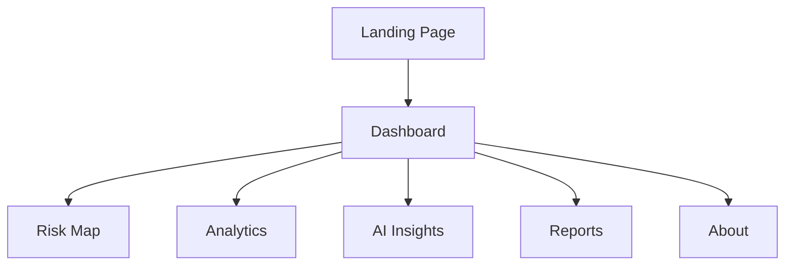

# Application Flow Document

## Project Name

Coastal Climate Risk Intelligence Dashboard

---

# Version

| Field | Value |
|--------|--------|
| Version | 1.0 |
| Status | Draft |
| Document Type | Application Flow |
| Target Platform | Web Application |

---

# Purpose

This document defines the complete user journey, navigation structure, and interaction flow of the Coastal Climate Risk Intelligence Dashboard.

It serves as a blueprint for frontend development, backend integration, and user experience planning.

---

# Application Overview

The application enables users to:

- Visualize climate risks on an interactive map
- Explore statistical climate analytics
- View AI-generated climate advisories
- Analyze historical environmental trends
- Export analytical reports

The application is designed to provide an intuitive experience while presenting complex environmental information in an understandable way.

---

# Primary Navigation

```text
Home Dashboard

├── 🌍 Risk Map
│
├── 📊 Analytics
│
├── 🤖 AI Insights
│
├── 📄 Reports
│
└── ℹ About
```

---

# Application Navigation Flow



---

# User Journey

## Step 1 — Open Application

User opens the web application.

↓

Dashboard loads.

↓

Latest environmental data is displayed.

---

## Step 2 — Explore Risk Map

User selects the **Risk Map** module.

System displays:

- Interactive map
- Coastal boundaries
- Risk heatmap
- Layer controls

---

## Step 3 — Select a Coastal Zone

User clicks on a coastal region.

System displays:

- Risk Score
- Rainfall
- Tide Height
- Elevation
- Historical Flood Data

---

## Step 4 — AI Explanation

User selects **Generate AI Insight**.

System generates:

- Climate Summary
- Risk Explanation
- Recommendations

---

## Step 5 — Analytics

User navigates to **Analytics**.

System displays:

- Rainfall trends
- Tide trends
- Risk distribution
- Correlation charts
- Historical comparisons

---

## Step 6 — Reports

User navigates to **Reports**.

System allows:

- PDF Export
- CSV Export
- Executive Summary

---

# Feature Flow

```mermaid
flowchart LR

Dashboard

-->

Risk Map

-->

Zone Details

-->

Risk Score

-->

AI Advisory

-->

Reports
```

---

# Dashboard Flow

```mermaid
flowchart TD

Dashboard

--> Risk Map

Dashboard

--> Analytics

Dashboard

--> AI Insights

Dashboard

--> Reports

Dashboard

--> About
```

---

# Risk Map Flow

```mermaid
flowchart TD

Risk Map

-->

Select Region

-->

Risk Details

-->

Analytics

-->

AI Recommendation

-->

Export
```

---

# Analytics Flow

```mermaid
flowchart TD

Analytics

-->

Rainfall

Analytics

-->

Tide

Analytics

-->

Risk Distribution

Analytics

-->

Historical Trends

Analytics

-->

Correlation Analysis
```

---

# AI Insights Flow

```mermaid
flowchart TD

Select Zone

-->

Retrieve Climate Data

-->

Generate Prompt

-->

LLM

-->

AI Summary

-->

Display Recommendation
```

---

# Report Generation Flow

```mermaid
flowchart TD

Select Report Type

-->

Generate Report

-->

Download PDF

Generate Report

-->

Download CSV
```

---

# Screen Descriptions

## Landing Dashboard

Purpose

Provide an overview of the current climate situation.

Displays

- KPI Cards
- Quick Statistics
- Navigation
- Latest Updates

---

## Risk Map

Purpose

Visualize climate risks geographically.

Displays

- Interactive Map
- Heatmaps
- Risk Layers
- Region Details

---

## Analytics

Purpose

Present statistical insights.

Displays

- Charts
- Graphs
- Historical Trends
- Correlation Analysis

---

## AI Insights

Purpose

Explain climate risks in natural language.

Displays

- Executive Summary
- Recommendations
- Risk Explanation

---

## Reports

Purpose

Generate downloadable reports.

Displays

- PDF Export
- CSV Export
- Summary Report

---

## About

Purpose

Provide project information.

Displays

- Project Description
- Technology Stack
- Contributors
- Version Information

---

# User Actions

| User Action | System Response |
|-------------|----------------|
| Open Dashboard | Load latest data |
| Select Region | Display regional statistics |
| View Analytics | Generate charts |
| Request AI Insight | Generate advisory |
| Export Report | Download report |

---

# Error Flow

If environmental data cannot be loaded:

↓

Display informative error message.

↓

Allow user to retry.

↓

Log the error for diagnostics.

---

# Empty State Flow

If no data is available:

- Display "No Data Available"
- Explain the reason
- Suggest refreshing or trying later

---

# Future Navigation

Future versions may include:

- User Authentication
- Notifications
- Saved Reports
- Multi-city Selection
- Settings
- AI Chat Assistant

---

# Application Flow Summary

The application is intentionally designed around a simple workflow:

1. Explore environmental data.
2. Understand climate risks.
3. Analyze statistical insights.
4. Review AI-generated recommendations.
5. Export actionable reports.

This flow minimizes user complexity while supporting informed decision-making.