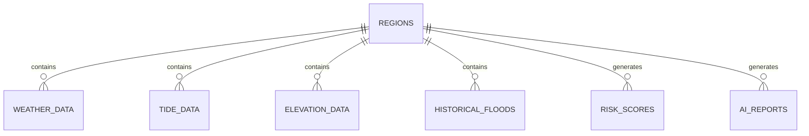
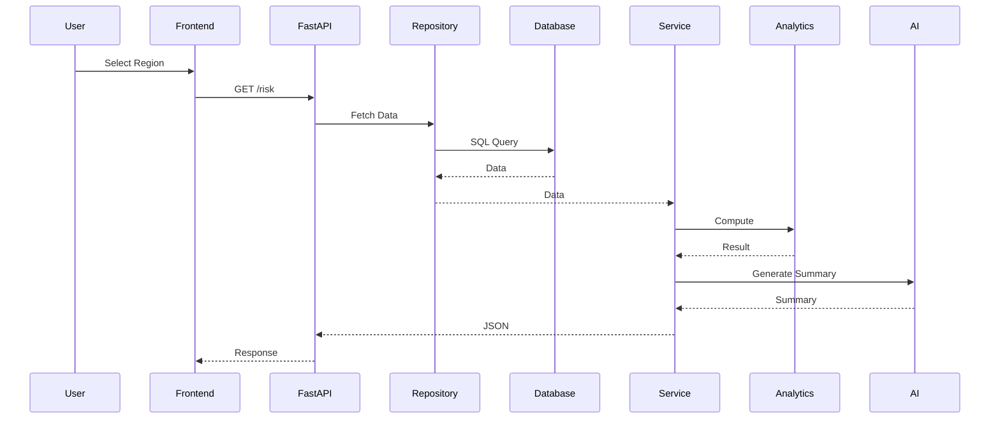

# Backend Schema & System Architecture

## Project Name

Coastal Climate Risk Intelligence Dashboard

---

# Version

| Field | Value |
|--------|--------|
| Version | 1.0 |
| Status | Draft |
| Architecture | Modular Service-Oriented Architecture |
| Backend Framework | FastAPI |

---

# Purpose

This document defines the backend architecture, database schema, service interactions, API contracts, data flow, caching strategy, and AI integration for the Coastal Climate Risk Intelligence Dashboard.

It serves as the engineering blueprint for backend development.

---

# Backend Overview

The backend follows a modular service-oriented architecture.

```

Frontend

↓

REST API

↓

FastAPI

↓

──────────────────────────────

Data Service

Analytics Service

Geospatial Service

Climate Risk Engine

AI Service

──────────────────────────────

↓

Repository Layer

↓

PostgreSQL + PostGIS

↓

Redis Cache

```

---

# Backend Folder Structure

```
backend/

│

├── app/

│ ├── api/

│ ├── config/

│ ├── core/

│ ├── database/

│ ├── repositories/

│ ├── services/

│ ├── analytics/

│ ├── geospatial/

│ ├── ai/

│ ├── middleware/

│ ├── models/

│ ├── schemas/

│ ├── utils/

│ └── main.py

│

├── tests/

├── requirements.txt

└── Dockerfile
```

---

# Module Responsibilities

## API Layer

Responsible for

- HTTP Endpoints
- Request Validation
- Response Formatting
- Error Handling

---

## Service Layer

Responsible for

- Business Logic
- Data Processing
- Risk Computation
- AI Calls

No SQL queries should exist here.

---

## Repository Layer

Responsible for

- Database Queries
- CRUD
- Spatial Queries

Only repositories communicate with PostgreSQL.

---

## Analytics Module

Responsible for

- Trend Analysis
- Correlation Analysis
- Historical Analytics

---

## Geospatial Module

Responsible for

- GIS Processing
- Heatmaps
- Buffer Analysis
- Polygon Operations

---

## AI Module

Responsible for

- Prompt Construction
- Executive Summary
- Recommendations
- Explainability

---

# Database Design

## Database

PostgreSQL

Extension

PostGIS

---

# Database Tables

## weather_data

Stores weather observations.

Fields

- id
- timestamp
- rainfall
- temperature
- humidity
- wind_speed
- pressure

---

## tide_data

Stores ocean observations.

Fields

- id
- timestamp
- tide_height
- wave_height
- sea_surface_temperature

---

## regions

Stores administrative boundaries.

Fields

- id
- name
- district
- geometry (Polygon)

---

## elevation_data

Stores elevation information.

Fields

- id
- region_id
- elevation
- slope

---

## historical_floods

Stores historical flood events.

Fields

- id
- region_id
- year
- severity

---

## risk_scores

Stores generated climate risk.

Fields

- id
- region_id
- timestamp
- rainfall_score
- tide_score
- elevation_score
- flood_score
- final_score
- risk_level

---

## ai_reports

Stores AI generated reports.

Fields

- id
- region_id
- timestamp
- summary
- recommendations
- confidence

---

# Database Relationships



---

# API Architecture

```
Client

↓

FastAPI

↓

Services

↓

Repositories

↓

Database
```

---

# REST Endpoints

## Weather

GET

/api/weather

Returns latest weather observations.

---

## Tide

GET

/api/tides

Returns tide information.

---

## Regions

GET

/api/regions

Returns all coastal regions.

---

## Risk

GET

/api/risk

Returns calculated climate risk.

---

## Analytics

GET

/api/analytics

Returns statistical analytics.

---

## AI

GET

/api/ai-report

Returns executive summary.

---

## Reports

GET

/api/reports

Returns downloadable reports.

---

# API Response Format

```
{
"success": true,
"message": "Success",
"data": {}
}
```

---

# Request Lifecycle



---

# Redis Cache

Used for

- Weather Cache
- Tide Cache
- Analytics Cache
- AI Cache

Cache Duration

15 Minutes

---

# Background Tasks

FastAPI Background Tasks

Responsible for

- Refresh Weather Data
- Refresh Tide Data
- Generate Reports
- Update Risk Scores

---

# Error Handling

Examples

400

Invalid Request

404

Data Not Found

500

Internal Server Error

503

AI Service Unavailable

---

# Logging

Log Levels

- INFO
- WARNING
- ERROR

Future

Centralized Logging

---

# Security

- HTTPS
- Environment Variables
- SQL Injection Protection
- Input Validation
- CORS
- Rate Limiting (Future)

---

# Performance

Target Response Times

Weather API

<300ms

Risk Engine

<5s

AI Report

<10s

Dashboard

<3s

---

# Future Backend Enhancements

- Authentication
- WebSockets
- Real-Time Streaming
- Kubernetes
- Message Queues
- Distributed Cache
- Microservices